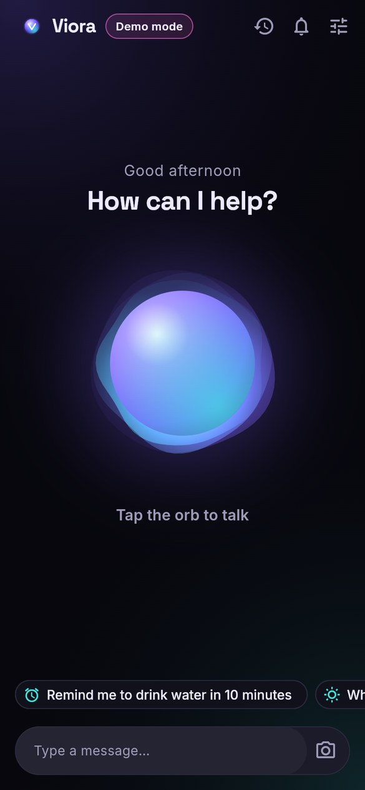
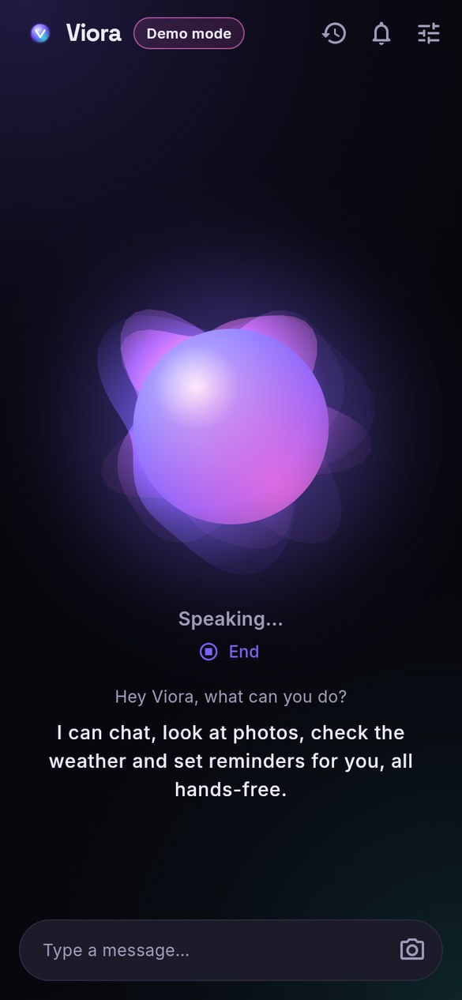
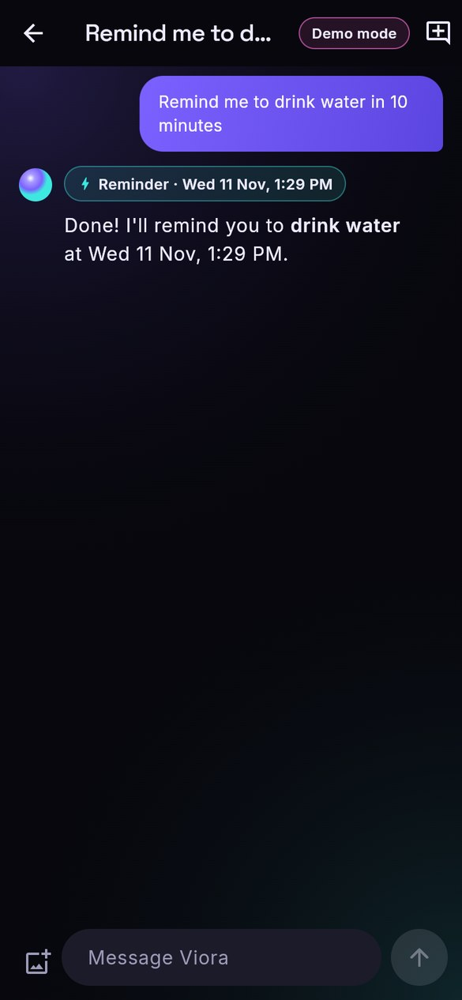
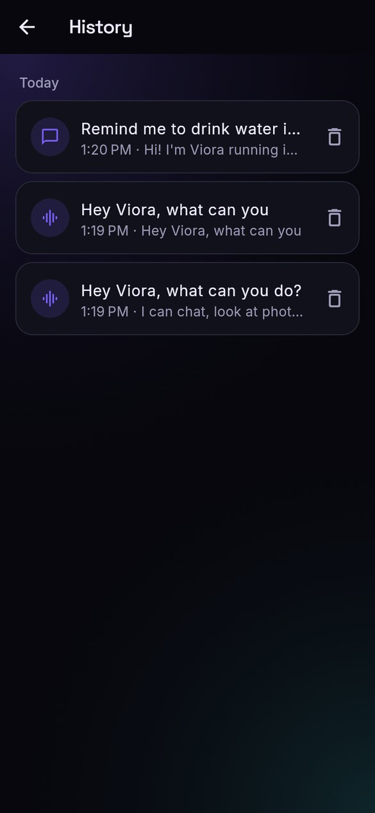
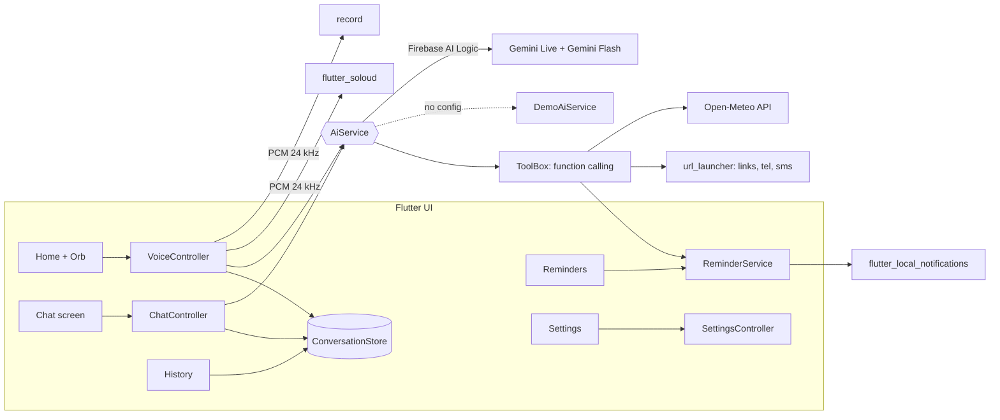

<p align="center">
  
</p>

<h1 align="center">Viora</h1>
<p align="center"><b>A real-time AI voice assistant built with Flutter and Gemini Live.</b><br/>
Talk naturally, interrupt anytime, show it a photo, and let it set reminders for you.</p>

<p align="center">
  
  
  
  
  
</p>

<p align="center">
  
  
  
  
</p>

## Features

| | |
|---|---|
| 🎙️ **Real-time voice** | Two-way audio streaming with the **Gemini Live API**. Viora answers out loud, can be interrupted mid-sentence, and shows live transcripts. The orb reacts to your voice level and to each state: idle, connecting, listening, speaking. |
| 💬 **Chat with memory** | Streaming answers rendered as markdown. Each conversation keeps its context, and voice mode also gets your most recent conversation as context. |
| 📷 **Photo Q&A** | Snap or pick a photo and ask about it (multimodal Gemini). |
| ⚡ **Actions (function calling)** | Set and list reminders, check the date/time, get the weather (Open-Meteo), open links, search the web, call or text someone. Calls and texts always ask you first. Chat and voice share one tool registry. |
| ⏰ **Real reminders** | Scheduled local notifications on Android, which survive reboots. The web build reminds you in-app. |
| 🗂️ **History** | Chat and voice conversations are saved on the device. Reopen one to continue it, or delete it (with undo). |
| 🎨 **Design** | Dark-first UI with a custom-painted animated orb, light theme, Hindi/English replies, a choice of voices, and a reduce-motion option. |
| 🧪 **Demo mode** | With no Firebase config, Viora runs with an offline scripted AI that still uses the real tools, so anyone can try it. |

## Architecture



- **Layers:** `core/` (config, theme) → `data/` (models, stores) → `services/` (AI, tools, reminders, audio) → `features/` (screens + controllers) → `widgets/`.
- **State:** `provider` with `ChangeNotifier` controllers. Every platform dependency (AI, mic, speaker, storage, notifications, launcher, photo picker) sits behind an interface, so all tests run offline with fakes.
- **Security:** the app ships with **no Gemini API key**. Gemini is called through Firebase AI Logic and protected by Firebase App Check; Firebase settings are injected at build time from a git-ignored file.

## Getting started

```bash
git clone https://github.com/<you>/viora.git
cd viora
flutter pub get
flutter run                      # runs in demo mode, no setup needed
```

### Connect real Gemini (Firebase AI Logic)

1. Create a project at [console.firebase.google.com](https://console.firebase.google.com). Open **AI Logic**, click **Get started** and pick the **Gemini Developer API**.
2. Add an **Android app** (`com.amandeep.viora`) and a **Web app** to the project.
3. Copy `firebase.env.example.json` to `firebase.env.json` (git-ignored) and fill in the values from *Project settings → Your apps*.
4. Authorise your build with **App Check** (Firebase AI Logic requires it):
   - In the console, open **Security → App Check → Apps**, open the menu next to your app and choose **Manage debug tokens → Add debug token**. Generate a token and save it.
   - Put the same token in `firebase.env.json` as `APP_CHECK_DEBUG_TOKEN`.
5. Run with the config:

```bash
flutter run --dart-define-from-file=firebase.env.json
flutter build apk --release --dart-define-from-file=firebase.env.json
```

> **Keep debug-token builds private.** A build made with `APP_CHECK_DEBUG_TOKEN` carries that token, so share it only with people you trust. For a public build, leave the token empty: Android then uses **Play Integrity** and web uses **reCAPTCHA Enterprise** (set `RECAPTCHA_ENTERPRISE_SITE_KEY`), both configured under *App Check → Apps*. Or publish the demo-mode build (`--dart-define=VIORA_DEMO=true`), which needs no Firebase at all.

## Download

Grab the APK from the [Releases](../../releases) page. To build smaller per-device APKs yourself:

```bash
flutter build apk --release --split-per-abi --dart-define-from-file=firebase.env.json
```

## Testing

```bash
flutter analyze
flutter test        # unit + widget tests, all offline
```

Tested on a real Android phone (Realme RMX3867, Android 16), in Chromium at phone and desktop sizes, and with 57 automated tests.

The tests cover the voice state machine (connect, speak, interrupt, reconnect, mic denied, stop while connecting), chat memory and error recovery, history storage limits, every tool (reminders, weather, links, call/SMS confirmation), settings, the demo AI, and widget flows for every screen. CI runs analyze, test and the web + APK builds on each push (`.github/workflows/ci.yml`).

## Project structure

```
lib/
  core/        config (build-time flags), theme
  data/        models, conversation store, key-value storage
  services/    ai/ (Gemini + demo), tools/, reminders/, voice/ (mic + speaker), platform/
  features/    home, chat, history, reminders, settings, onboarding, voice controller
  widgets/     animated orb, shared UI
test/          fakes + unit and widget tests
```

## Roadmap

- Wake word ("Hey Viora") and an Android home-screen widget
- Cloud sync of history with Firebase Auth + Firestore
- Grounded answers with Google Search

## Credits

Fonts: Inter and Space Grotesk (SIL Open Font License). Weather data: [Open-Meteo](https://open-meteo.com). Built by **Aman Deep**. MIT licensed.
